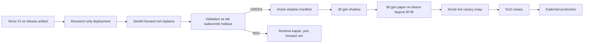

# ParayaBuck üretime geçiş yol haritası

Tarih: 2026-08-09

## 1. Yayın tanımı

ParayaBuck için üç ayrı yayın seviyesi vardır ve bunlar birbirine karıştırılmamalıdır:

1. **Research-only platform yayını:** Web arayüzü, veri hattı, araştırma motoru ve
   gözlemlenebilirlik çalışır; broker'a emir gönderilmez.
2. **Shadow/paper yayını:** Yalnızca GREEN approval manifest sahibi sleeve çalışır. Shadow'da
   broker submit yoktur; paper'da yalnız Alpaca paper hesabı kullanılır.
3. **Live canary yayını:** Forward holdout, shadow ve paper kapıları geçildikten sonra ayrı
   operatör onayı ve dolar limitiyle gerçek hesaba sınırlı emir gönderilir.

Kodun deploy edilebilir olması, stratejinin live işlem açmaya yetkili olduğu anlamına gelmez.
Geçerli approval manifest yoksa runtime'ın exposure artırmaması doğru ve tamamlanmış davranıştır.

## 2. Bugünkü durum

| Alan | Durum | Yayın etkisi |
|---|---|---|
| Backtest/runtime doğruluğu | 450 test, Ruff ve mypy geçiyor | Kod tabanı aday |
| Fail-closed aktivasyon | Uygulandı | Geçersiz manifestte emir yok |
| Equity vNext | Preregistered, forward holdout bekliyor | En erken 2027-02-09 |
| Crypto vNext | Preregistered, forward holdout bekliyor | En erken 2027-08-09 |
| Approval manifest | Şema ve doğrulama hazır, GREEN manifest yok | Trading kapalı |
| Paper olay incelemesi | CLI/replay hazır, gerçek hesap indirmesi yapılmadı | P0 blocker |
| Deployment altyapısı | Docker/service/IaC tanımı yok | P0 blocker |
| Operasyon telemetrisi | Runtime health var, harici alarm ve tam dashboard yok | P0 blocker |
| Dependency/secret audit | CI kapıları var, temiz ortam sonucu bekleniyor | P0 blocker |

## 3. Kritik yol

## 4. Faz 0 — Main ve release hijyeni

Hedef süre: 1-2 iş günü.

- `main` için branch protection açılmalı; CI geçmeden merge ve doğrudan push engellenmeli.
- Temiz Python 3.11, 3.12, 3.13 ve 3.14 ortamlarında şu kapılar gerçekten çalıştırılmalı:
  Ruff check/format, mypy, pytest, wheel build ve smoke test, `pip-audit`, gitleaks.
- `requirements.lock` ile temiz kurulum yapılmalı ve `websockets.legacy` uyarısının temiz ortamda
  kaybolduğu doğrulanmalı. Bir sürüm düşürme güvenlik bulgusu üretirse uyarı filtrelenmemeli;
  Alpaca stream adaptörü güncel API'ye taşınmalı.
- Tekrarlanabilir bir release artifact oluşturulmalı. Artifact etiketi kaynak commit'i içermeli ve
  checksum yayımlanmalı.
- SemVer ve release-note politikası belirlenmeli; ilk güvenli platform sürümü `v0.2.0` olabilir.

Çıkış kriteri: Dört Python sürümünde tüm CI kapıları yeşil, wheel temiz bir ortamda import
edilebiliyor ve secret/dependency audit sonucu sıfır çözülmemiş yüksek/kritik bulgu.

## 5. Faz 1 — Paper kaybı olay incelemesi

Hedef süre: 2-4 iş günü.

- `scripts/reconcile_paper_incident.py` ağ erişimi olan güvenli bir operatör ortamında çalıştırılmalı.
- Emir ve fill sayfalamasının tüm hesap geçmişini kapsadığı broker kayıt sayılarıyla doğrulanmalı.
- Yaklaşık 800 dolarlık değişim; brüt gerçekleşmiş PnL, gerçekleşmemiş PnL, fee,
  slippage/spread, manuel çıkış, bot dışı pozisyon, eksik ve duplicate emir olarak ayrıştırılmalı.
- Başlangıç/bitiş equity snapshot'ı ve para transferleri eklenerek açıklanamayan bakiye farkı
  ayrı bir residual alanında gösterilmeli.
- Kimlikleri temizlenmiş gerçek replay fixture test paketine alınmalı. Fixture, günlük zarar veya
  drawdown haltını ve risk azaltıcı satışların serbest kaldığını kanıtlamalı.
- Olay için yazılı root-cause ve "aynı kayıp sınıfı neden tekrar edemez" kanıtı hazırlanmalı.

Çıkış kriteri: Broker ile yerel ledger arasındaki tüm farklar açıklanmış, residual cent seviyesinde
ve replay testi CI'da geçiyor.

## 6. Faz 2 — Deployment ve operasyon temeli

Hedef süre: 3-5 iş günü.

- Uzun ömürlü WebSocket bağlantıları ve SQLite nedeniyle ilk dağıtım tek, kalıcı diskli Linux
  instance üzerinde yapılmalı; serverless çalışma modeli kullanılmamalı.
- Repo'ya production Dockerfile, healthcheck, non-root kullanıcı, read-only root filesystem ve
  graceful shutdown eklenmeli. SQLite, manifest, rapor ve log yolları ayrı kalıcı volume olmalı.
- Paper ve live tamamen ayrı deployment, Alpaca credential, veritabanı, manifest dizini ve alarm
  kanalı kullanmalı.
- Secret'lar `.env` dosyasıyla image içine alınmamalı; platform secret store üzerinden runtime'a
  verilmeli. Live operatör HMAC anahtarı Alpaca anahtarından farklı olmalı.
- Host UTC/NTP senkronizasyonu, otomatik güvenlik yamaları ve outbound allow-list uygulanmalı.
- Web paneli herkese açık bırakılmamalı; private network/VPN veya güçlü kimlik doğrulama ve TLS
  arkasında sunulmalı.
- SQLite için transaction-consistent günlük backup, şifreleme, en az 30 günlük retention ve aylık
  restore tatbikatı oluşturulmalı.
- Deployment sırasında önce veritabanı backup'ı alınmalı; eski artifact tek komutla geri
  döndürülebilmeli. Rollback mevcut ledger/HWM durumunu eski şemayla bozmamalı.

Çıkış kriteri: Research-only artifact 7 gün boyunca kesintisiz çalışıyor; restart sonrası state
parity korunuyor, backup restore tatbikatı geçiyor ve broker submit sayısı sıfır.

## 7. Faz 3 — Sürekli veri ve araştırma operasyonu

Başlangıç: hemen. Bitiş: devamlı.

- Equity için total-return, raw executable fiyat/hacim, quote/spread, corporate action ve
  point-in-time 3 aylık T-bill serisi günlük olarak toplanmalı.
- Crypto için Coinbase BTC/USD ve ETH/USD ana seri; Binance günlük checksum arşivi ve Alpaca
  venue karşılaştırması otomatik schedule ile çalışmalı.
- Her veri çalışması lineage, listing aralığı, gap raporu, provider sürümü ve content hash üretmeli.
- Ham veriler değiştirilemez saklanmalı; düzeltmeler yeni dataset sürümü oluşturmalı.
- Veri job'ları eksik gün, checksum hatası, venue sapması veya gecikmede fail-closed olmalı ve
  alarm üretmeli.
- Araştırma programı/family bütçesi korunmalı: piyasa başına 12 ayda en fazla üç aile.

Çıkış kriteri: 30 gün boyunca eksiksiz otomatik veri toplama, deterministik yeniden üretim ve
başarılı restore/rebuild kanıtı.

## 8. Faz 4 — Promotion ve approval araçları

Hedef süre: forward holdout olgunlaşmadan önce tamamlanmalı.

- Validation registry'den yalnız gate'i geçen trial'ı okuyabilen bir `promote_strategy` CLI
  eklenmeli; elle JSON manifest yazılması production yolu olmamalı.
- CLI; source commit, module hash, dataset hash, holdout terminal kaydı, gate-policy, expiry,
  universe ve allocation sınırlarını yeniden doğrulamalı.
- Shadow → paper → canary/live geçişleri için dört göz prensibi uygulanmalı: araştırmacı aday
  üretir, ayrı risk/operasyon sahibi onaylar.
- Manifest ve operatör onayı değiştirilemez audit log'a yazılmalı. Nonce yeniden kullanımı
  engellenmeli; expiry ve revoke akışı test edilmeli.
- RolloutController için operatör CLI/API ve kanıt raporu eklenmeli; doğrudan SQLite düzenleme
  geçerli geçiş yöntemi sayılmamalı.

Çıkış kriteri: Tamper, yanlış commit/dataset/account, expiry, revoke ve replay denemeleriyle
production promotion chaos testi geçiyor.

## 9. Faz 5 — Forward holdout ve GREEN kararı

### Equity

- Forward veri başlangıcı: 2026-08-09.
- En erken holdout değerlendirmesi: 2027-02-09.
- Validation geçen preregistered canonical aday için holdout yalnız bir kez açılmalı.

### Crypto

- Forward veri başlangıcı: 2026-08-09.
- En erken holdout değerlendirmesi: 2027-08-09.
- İlk aile RED olursa ikinci aile momentum/trend varyasyonu olmamalı.

Her sleeve; nakit üstü getiri, MaxDD, Sharpe, Sortino, Calmar, DSR, PBO, pozitif ay,
stress-cost, benchmark karşılaştırması, hedef ağırlık ve risk-contribution eşiklerinin tamamını
geçmeli. İki sleeve de GREEN ise senkron birleşik portföy MaxDD kapısı tekrar çalıştırılmalı.

Çıkış kriteri: Registry terminal, manifest hash'leri yeniden üretilebilir ve hiçbir eşik sonuç
görüldükten sonra değiştirilmemiş. RED sonucu yayın engeli değil, trading aktivasyon engelidir.

## 10. Faz 6 — Shadow

Minimum süre: 30 ardışık gün.

- Yalnız GREEN strateji için shadow-stage manifest oluşturulmalı.
- Production ile aynı scheduler, data feed, planner, risk overlay ve state repository çalışmalı;
  broker submit kesinlikle kapalı kalmalı.
- Her hedef için varsayımsal emir/fill, beklenen fee/slippage ve risk kararı kaydedilmeli.
- Veri gecikmesi, karar gecikmesi, duplicate/stale target, restart parity ve reconciliation
  dashboard/alarmları izlenmeli.
- En az iki kontrollü restart, bir veri kesintisi ve bir broker timeout tatbikatı yapılmalı.

Çıkış kriteri: 30 gün; duplicate/stale entry, state divergence ve çözümsüz reconciliation sıfır;
hiçbir risk limiti ihlali yok.

## 11. Faz 7 — Paper

Minimum süre: 90 gün ve aktif her sleeve için en az 50 fill.

- Paper-stage manifest kullanılmalı; live credential deployment'a hiç verilmemeli.
- Paper hesapta manuel işlem yapılmamalı. Zorunlu manuel işlem olursa incident olarak
  kaydedilmeli ve ölçüm penceresi risk sahibi tarafından yeniden değerlendirilmelidir.
- Her gün broker order/fill/position ile yerel ledger otomatik uzlaştırılmalı.
- Beklenen/gerçekleşen slippage, fee, fill oranı, missed order ve reject nedenleri raporlanmalı.
- Paper fill modelinin impact/queue/latency/fee/corporate-action sınırlamaları kabul raporunda
  açıkça yer almalı.

Çıkış kriteri: Süre ve fill sayısı tamam, duplicate order/state divergence/reconciliation olayı
sıfır, risk halt tatbikatları başarılı ve paper sonuçlarının yönü GREEN araştırmayla uyumlu.

## 12. Faz 8 — Live canary ve kademeli büyütme

- Ayrı live deployment ve account-bound HMAC operatör onayı kullanılmalı.
- İlk canary, validasyonu geçmiş hedeflerin yalnız %10'unu ve ayrıca açık dolar limitini uygular.
- Başlangıç limitleri değişmez: günlük kayıp %0,5; HWM drawdown %5; gross %60; equity %50;
  crypto %10; nakit en az %40; equity varlık %10, crypto varlık %5.
- Canary sırasında 24/7 alarm nöbeti, tek komut halt, broker-side cancel ve gerekiyorsa yalnız
  risk azaltıcı liquidation runbook'u hazır olmalı.
- Büyütme önerisi: %10 → %25 → %50 → %100. Her basamak en az 30 gün ve yazılı risk onayı
  gerektirir. Incident veya eşik ihlalinde bir önceki basamağa değil, shadow/paper'a dönülür.
- Kod/manifest/dataset değişikliğinde mevcut onay geçersiz sayılmalı ve rollout yeniden başlamalı.

Çıkış kriteri: Canary dönemi olaysız, broker/ledger parity tam, kayıp ve drawdown limitleri içinde,
rollback tatbikatı başarılı ve ayrı risk sahibi büyütmeyi imzalamış.

## 13. Telemetri ve alarm P0 listesi

Production öncesinde dashboard ve alarm katmanı şu alanları göstermelidir:

- Artifact/source commit, manifest checksum, stage ve expiry.
- Equity/crypto exposure, nakit, bot dışı pozisyon bütçesi ve risk contribution.
- Günlük PnL, realized/unrealized PnL, fee, dividend, slippage ve HWM drawdown.
- Veri timestamp/age, stream heartbeat, karar kuyruğu yaşı ve dropped/coalesced event.
- Client order → broker order → fill/activity zinciri.
- Reconciliation durumu, en son başarılı uzlaştırma ve unresolved incident sayısı.

Kritik alarmlar: veri gecikmesi, stale account, worker ölümü, disk doluluğu, backup hatası,
manifest expiry/tamper, duplicate order, ambiguous submit/cancel, reconciliation farkı, günlük
kayıp ve drawdown haltı.

## 14. Teorik en erken takvim

Bu tarihler yalnız tüm kapılar ilk denemede geçerse mümkündür:

| Sleeve | Holdout en erken | Shadow biter | Paper en erken biter | Live canary en erken |
|---|---:|---:|---:|---:|
| Equity | 2027-02-09 | 2027-03-11 | 2027-06-09 ve 50 fill | Haziran 2027 |
| Crypto | 2027-08-09 | 2027-09-08 | 2027-12-07 ve 50 fill | Aralık 2027 |

Research-only platform, Faz 0-3 tamamlandıktan sonra daha erken yayınlanabilir. Trading için bu
tarihlerin kısaltılması veya gate eşiklerinin gevşetilmesi kabul edilemez.

## 15. Tamamlanmış sayılma kriteri

Proje ancak aşağıdakilerin tamamında tamamlanmış sayılır:

- Temiz CI, imzalı/reproducible artifact ve geri dönüşü test edilmiş deployment.
- Gerçek paper kaybı root-cause raporu ve cent seviyesinde replay/ledger mutabakatı.
- Otomatik, hash'li, yedeklenmiş veri hattı.
- En az bir bağımsız GREEN sleeve ve geçerli approval manifest.
- 30 günlük shadow ile 90 günlük/50-fill paper kriterleri.
- Production telemetrisi, alarmlar, runbook, backup/restore ve halt tatbikatı.
- Account-bound operatör onayı ve açık live dolar limiti.

Bir stratejinin GREEN olmaması yazılım başarısızlığı değildir. Bu durumda platform research-only
olarak tamamlanmış ve yayında kalabilir; trading runtime fail-closed kalmalıdır.
