# Production crypto timing trace

Classification: `PRODUCTION_CAUSAL_HISTORICAL_FILL_PROXY_ONLY_BROKEN` for the inspected normal finalized-bar path. No evidence from this trace establishes a PAPER/LIVE same-boundary fill bug.

```mermaid
flowchart LR
  A[Alpaca 1m stream] --> B[AlpacaBarStream._convert]
  B --> C[EngineRuntime._on_bar]
  C --> D[TimeframeAggregator.update / flush_until]
  D --> E[EngineRuntime._emit_finalized_bar]
  E --> F[portfolio event batch]
  F --> G[PortfolioRuntime.process_closed_bars]
  G --> H[96h label-based RebalancePolicy]
  H --> I[strategy.decide + risk + planner]
  I --> J[repository.record_decision_with_orders]
  J --> K[_submit_orders]
  K --> L[broker.submit_portfolio_order]
  L --> M[broker fill price observed later]
```

`src/parayabuck/data/aggregator.py` creates start-labeled aggregates and `flush_until` releases a bucket only once its interval end plus configured finalization grace has passed. `EngineRuntime._on_bar` also emits a previous bucket only on arrival of a bar from a later bucket; the incoming minute bar itself is delivered after its represented minute. The runtime queues only finalized bars to the portfolio worker. `process_closed_bars` appends the closed bar, applies the existing label-based 96-hour cadence, builds context, generates target and orders, persists them, then calls `_submit_orders`. Broker submission and any actual market fill occur after the completed information is processed. The bar label used as the persisted decision key is **not** a physical order creation timestamp; this research adapter records both fields separately.

The current backtest instead decides on a full daily bar at its start label and fills a new order at the next daily bar's open. For 2021-04-01 this grants the 2021-04-02 00:00 print at the exact instant the final source component completes. The historical proxy is the proven defect. Late data corrections or broker execution latency can move the actual production decision/fill later; the selected historical proxy is a reproducible approximation, not a claim of exact live fill price.
